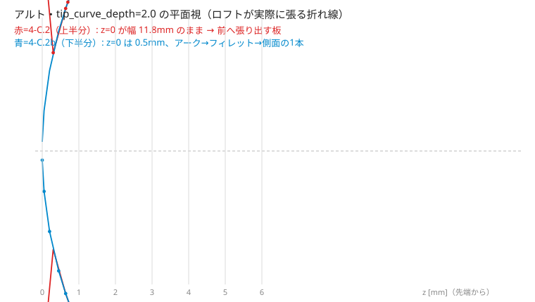
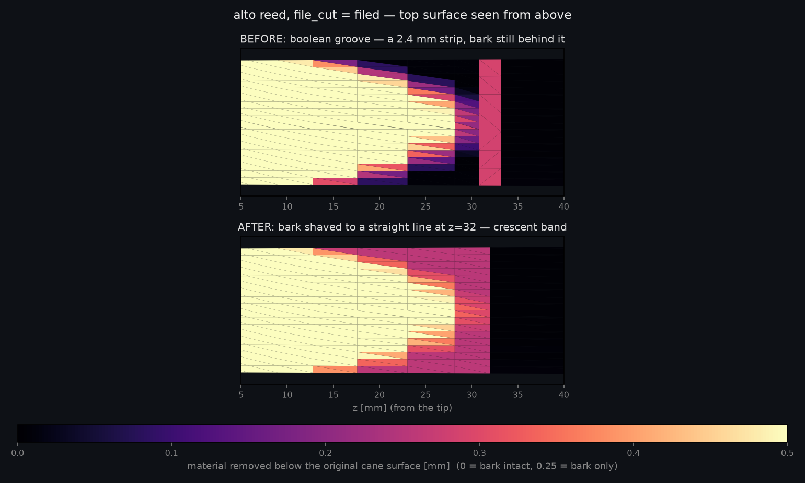

# リードの断面と前縁（Phase 4-C.2、2026-08-17）

Phase 3 のリードは**断面が長方形で前縁が直線**だった。実物の写真（Vandoren 25 / 26 /
27）と突き合わせると、どちらもモデルが実物の作りを持っていないところだった。
このスライスで直したのは 5 点。掃引は [`sweep_reed.py`](sweep_reed.py)。

## 1. カマボコ ── 上面は「削り面」と「ケーンの円弧」の低いほう

リードは竹のような円筒（ケーン）から D 形のブランクを切り出してから削るので、
削っていない所には円筒の外周が残る。だから厚みは

```
thickness(z, x) = min(削り面(z, x), ケーンの上面(x))
```

で、**ケーンの上面は z に依らない**（管はまっすぐだから）。円は 3 つの量で決まる:
中央厚と踵幅（どちらも規格値）と、**踵の側端厚**。

| | 中央厚 | 踵幅 | 側端厚（既定） | 導出されるケーン外径 |
|---|---|---|---|---|
| soprano | 2.6 | 13.5 | 0.9 | φ28.5 |
| alto | 2.8 | 14.0 | 0.9 | φ27.7 |
| tenor | 3.0 | 15.4 | 0.9 | φ30.3 |

**側端厚 0.9 は未実測**。実物のリードの踵端面で 1 点測れば決まる（他の 2 つは規格値
なので、残っている自由度はこれだけ）。**この値はどの照合カードの判定にも入っていない**
ので、外れていても判定は汚れない —— 動くのは材料体積と印刷時間だけ。

円弧が削り面に勝ち始めるのは **z ≈ 14.8 / 16.8 / 17.5**（ヴァンプの後ろ半分）。
先端側は削り面が勝つ（ティップの側端で削り面 0.21〜0.23 に対し円弧 1.39〜1.54）。

## 2. 断面が厚みの法則そのものになった（食い違っていた）

`sections()` は角丸長方形（`builders.flat_bottom_rect_pts`）で張っていて、
`thickness(z, x)` の分布を再現していなかった。測ると

| | 断面が張る体積 | 報告していた材料体積 | 先端断面（断面 vs 法則） |
|---|---|---|---|
| soprano | 1581（+1.6%） | 1555 mm³ | 4.357 vs 3.779 mm²（**+15%**） |
| alto | 2132（+1.6%） | 2098 mm³ | 4.706 vs 4.082 mm²（**+15%**） |
| tenor | 2761（+1.6%） | 2717 mm³ | 5.444 vs 4.722 mm²（**+15%**） |

**印刷される形と、BOM・断面二次モーメントが読んでいる法則が別物**だった。
カマボコは角丸長方形では表せないので、ここで一本化した ——
上面は `thickness(z, x)` を x 方向に 19 点サンプリングして直接追う。

点の作り方は 2 つの規則で決まっている:

- **点数は全断面で一定**（底辺 2 ＋ 上面 19 ＝ 21）。`loft_sections` のルールド
  ロフトは頂点対応ではなくパラメータ対応で面を張るので、断面ごとに点数が変わると
  角が辺の途中に写像されて面がねじれる。
- **奇数個にして x=0 を必ず含める**。中央は背骨の稜線（断面の最大高さ）なので、
  跨いでサンプルすると稜線が全長にわたって平らな面になる（偶数個で実際にそうなり、
  「底面が平坦」のテストが最大高さの不一致で落ちた）。

19 点での断面積の誤差は最悪 **0.10%**。10 点だと 0.40%、27 点にしても 0.06% まで
しか改善しない。端に寄せた分布にしても差は 0.02% 以下だったので等間隔で足りる。

## 3. 前縁はティップレールに沿う曲線

`profiles.tip_contour_z(p, x)` を新設した。胴をリード面で切った断面の縁で、
x での胴の下端がリード面に達する z を解く:

| | x=0 | 中央の 60% | 角（x=±幅/2） |
|---|---|---|---|
| soprano | 0.103 | 0.592 | **1.515**（落ち込み 1.412） |
| alto | 0.117 | 0.645 | **1.385**（落ち込み 1.268） |
| tenor | 0.130 | 0.760 | **1.700**（落ち込み 1.569） |

**角は中央より 1.27〜1.57mm 後ろ**。前縁が直線だったので、リードは角でそのぶん
ティップレールから前へ張り出していた（`tip_corner_r` の 0.8mm 半径はこの 1/2 以下で
向きも違う）。既定の `tip_curve_depth` は 0.1mm 刻みで最良の値と一致する
（soprano 1.4 / alto 1.3 / tenor 1.6）。

**円弧では輪郭に 0.1mm より近づけない** —— 実物の輪郭は真円ではないので、既定同士でも
最大ずれが soprano +0.094 / alto −0.103 / tenor −0.118 残る。判定のしきい値 0.3 は
この残差を警告にしない値。**自動追従はしない**（市販のリードは規格品で、特定の
マウスピースに合わせては作られていない）。カードは数字を出すだけ。

## 4. 硬さモデルの荷重幅を代理変数から外した

`reed_model._bending` は等分布荷重を `w = 0.001 * width(p, 0.0)` で作っていた。
**z=0 の幅**を「リードの幅」の代理にしていたので、前縁カーブを入れると z=0 は幅ゼロの
尖点になり、荷重が 1/27 に落ちて **3 サイズとも硬さ相当が上限 20.0 に振り切れ、
推奨先端厚が 0.02mm になった**。

息圧が乗るのは「先端の幅」であって「z=0 の断面の幅」ではないので、
`reed_profiles.tip_load_width` ＝ 先端幅 − 2×角の丸み に置き換えた。
**前縁カーブが 0 のときは `width(p, 0.0)` とビット一致**する（測って確認済み）。

## 5. ファイルドカットを円弧に沿わせた

水平な屋根（`yz_profile_cut_solid`）で削っていたので、カマボコの上では中央の冠だけが
平らに落ちて（アルトで幅 5.2mm）、全幅に走る「横一文字」にならない。
円弧を `depth` 下げた曲線は**同じ半径の円**なので、`builders.extrude_arc_prism` の
3 点円弧で厳密に表せる。

## 掃引で見つけた組合せ ── ブランクは管に収まらないといけない

`sweep_reed.py` を回すと 2 通りが壊れた:

| | 症状 |
|---|---|
| `tip_width = 18.0`（踵幅 14.0） | 断面の最小 y = **−0.45**（テーブル面より下） |
| `heel_width = 9.0`（先端幅 13.4） | 断面の最小 y = **−3.48**、ソリッドが `is_valid=False` |

どちらも同じ原因で、**リードが元のケーン管より広い**。上面が円弧になった以上、
管に収まらない幅を指定すると円弧がテーブル面より下へ潜って断面が裏返る。

**2 つのパラメータの関係**なので `ParamSpec` の範囲では表せない（幅を狭くしても
側端厚を上げても成立する）。`reed_profiles.cane_layout_error` を書いて
`Component.params_error` へ回した ——「黙ってクランプしない」の既存の出口。

## 動いた記録値 / 動かなかったもの

| | f_reed | 硬さ相当 | 材料体積 | 推奨先端厚 |
|---|---|---|---|---|
| soprano | 945.7 → 949.5（**+0.40%**） | 4.091 → 4.083 | 1555 → **1299（−16.5%）** | 0.350 → 0.350 |
| alto | 745.2 → 747.7（**+0.34%**） | 2.675 → 2.671 | 2098 → **1738（−17.2%）** | 0.462 → 0.463 |
| tenor | 602.8 → 605.1（**+0.38%**） | 2.034 → 2.015 | 2717 → **2233（−17.8%）** | 0.695 → 0.711 |

f_reed が動いたのは**先端カーブのほう**で、カマボコ単体では 0.06% 以内だった
（断面二次モーメントは中央の厚みが支配するので、極端な x の薄い部分を落としても
剛性は動かない）。ブレードが実際に先端側で細くなったぶんなので、隠さず記録する。

**動かなかった**: `cad/windycity/verify_report.md` は diff **0 行**。
`verify_base.py` がリードから読むのは `profiles.reed_chord`（マウスピース側の幾何）
だけで、リード コンポーネントを一切通らない。Tier1/Tier2 とマウスピース側も不変。
リガチャーも不変 —— `reed_thickness()` は中央厚＝最大値を読むので余裕の判定は
変わらない。ただし**平らな圧力プレートは冠にしか当たらなくなった**ので、
そこは 4-C.3 の接触形状で扱う。

## 4-C.2b（2026-08-17）── 平面視の輪郭を 1 本の曲線にした

上の実装を 3D ビューで見たユーザーから「**前縁から平たいヒレが前へ出る**」と
報告があった（アルト・`tip_curve_depth = 2.0`）。切り分けたら独立した 3 件で、
うち 1 件は**既定値でも出ていた**。

### ① z=0 が円弧クランプから漏れていた（ヒレの正体）

`if 0.0 < z < d:` は **z=0.0 を含まない**（`0.0 < 0.0` は偽）。最先端の断面だけ
前縁カーブが効かず、幅が「テーパー − 2·角の丸み」のまま残る:

| | `width(0)` | `width(1e-9)` | 次のステーション | 輪郭の垂直ずれ |
|---|---|---|---|---|
| soprano | **11.500** | 0.500 | z=0.210 で 5.10 | **2.31 mm** |
| alto | **11.800** | 0.500 | z=0.195 で 5.27 | **2.39 mm** |
| tenor | **13.000** | 0.500 | z=0.240 で 5.85 | **2.68 mm** |

ロフトが「全幅 11.8 × 厚さ 0.4mm の板」から「5.3mm 幅」へ**後ろ向きに絞る**ので、
円弧より前へ razor 状の板が出る。`tip_curve_depth = 0` では条件式ごと偽になるので
旧形状は無傷だった。

**なぜ素通りしたか**: 掃引が見ていたのはソリッド数・水密・winding・bbox・頂点数で、
どれも通ってしまう（bbox は幅が正しい側の値を拾う）。テスト側も
`width(p, 0.0)` を **depth > 0 で一度も評価していなかった** ——
`test_reed_tip_curve_*` が触るのは `front_edge_z` と `tip_load_width` だけ。

### ② 角の丸みが円弧の後ろに積まれていた

`−2r` を z ≤ d の全域で引いてから円弧と `min` を取っていたので、輪郭が 4 区間に
割れていた（alto 既定）:

```
 z=0.00→1.00  円弧      x 0→5.90     dx/dz 11.05→2.91
 z=1.00→1.30  平行帯    x 5.90→5.91  dx/dz 0.004      ← 円弧が 2r で頭打ち
 z=1.30       角(d)                  dx/dz →5.57      ← 傾きが跳ぶ
 z=1.30→2.10  角の丸み  x 5.91→6.71
 z=2.10       ここで全幅                              ← d ではなく d+r
```

- 円弧は `tip_width` に届かず `tip_width − 2·tip_corner_r` で切れていた。
- 全幅に達するのは z = d + r で、パラメータのラベル（角が中央よりどれだけ後ろか）
  が指す d ではない。
- 適合カードが使う `front_edge_z`（純円弧）が実輪郭と**角で丸み半径ぶんずれる**:
  x=0.99·半幅 で 実輪郭 1.788 / 式 1.371（soprano）、1.763 / 1.273（alto）、
  2.124 / 1.567（tenor）。カードの許容差 0.3mm より大きい。



上図はロフトが**実際に張る折れ線**（点がステーション）。上半分が 4-C.2 で、
z=0 の半幅 5.90mm から次のステーションの 2.64mm へ落ちている。
実際にビルドしたソリッドの比較は [`tip_render_4c2b.png`](tip_render_4c2b.png)。

### 直したあと ── 輪郭は「前縁アーク → 半径 r のフィレット → 側面」の 1 本

フィレットは前縁アークと側面の両方に内接する円 1 個で、中心が x = a − r に
あることから z が閉形式で出る。R ≥ 先端半幅 は恒等的に成り立つ（相加相乗）ので
解は常に存在し、`params_error` は要らない。

| | 全幅到達 z（旧 → 新） | 角の逃げ | 傾きの跳び（旧 → 新） | 輪郭のずれ |
|---|---|---|---|---|
| soprano | 2.10 → **1.862** | +0.462 | +118.3 → **+0.0044** | 2.31 → **0.25**\* |
| alto | 2.10 → **1.852** | +0.552 | +126.5 → **+0.0023** | 2.39 → **0.25**\* |
| tenor | 2.50 → **2.194** | +0.594 | +134.2 → **+0.0033** | 2.68 → **0.25**\* |

\* 残っている 0.25 は最先端の**幅の下限 0.5mm** そのもの（ロフトが点に潰れないよう
断面を細片で立てる）。それを除いた残差はステーション刻みで 1e-14 まで落ちている。

ステーションは `tip_curve_depth` に対する比ではなく**輪郭自身の幾何から**起こす
（2 つの円をそれぞれ等角で刻む: アーク 6 点 ＋ フィレット 4 点）。半幅は z の
平方根で立ち上がるので、等間隔だと最先端が粗くなる。**カーブ 0 のときは 1 点も
足さない** —— 旧形状はロフトのステーションまで据え置く。

### 記録値（4-C.2 → 4-C.2b）

| | 材料体積 | f_reed | 硬さ相当 |
|---|---|---|---|
| soprano | 1298.5 → 1298.5（+0.00%） | 949.5 → 949.4（**−0.015%**） | 4.083 → 4.081 |
| alto | 1738.1 → 1738.0（−0.00%） | 747.7 → 747.5（**−0.026%**） | 2.671 → 2.670 |
| tenor | 2233.0 → 2233.0（−0.00%） | 605.1 → 604.9（**−0.029%**） | 2.015 → 2.014 |

ヒレは薄くて短い（全幅 × 0.4mm × 0.2mm）ので体積はほぼ動かない。
`_bending` は z = l_eff/96 から刻むので z=0 を踏まず、f_reed が動いたのは輪郭が
滑らかになったぶんだけ。`edge_thickness` は q = |x|/半幅 が 1 で不変なので、
仕様書の「先端厚（中央/側端）」も印刷カードも動かない。
**`verify_report.md` は 0 行**（`verify_base.py` はリード部品を通らない）。

### 適合カードの読み方が変わった

前縁の最大ずれは**アークが効く区間だけ**で測る（角の丸みが効く所はリードが
意図的に逃げている）。既定同士の値は 4-C.2 と同じ **soprano +0.094 /
alto −0.103 / tenor −0.118**。角の逃げは「角の位置（リード / MP）」の行が
別に出す（**警告にしない** —— 丸み半径ぶんの後退は形状の仕様）。

**直線の前縁が張り出す量の記録値は下がった**（1.27〜1.57 → **1.012 / 0.990 /
1.202**）。形が変わったのではなく、旧 `front_edge_z` が角の丸みを見ていなかった
ので張り出しを過大に報告していた。

### ③ 1 つめのバグが 2 つめのバグを覆い隠していた

`width(p, 0.0)` を直したら、**物理モデル音の合成が壊れた**（倍音比の L1 差が
1.42 → 0.0006、両方の硬さで純正弦になった）。`reed_model.reed_override` の
`width_mm` も `width(p, 0.0)` を読んでいて、これは OpenWind のリード**流路**の幅
（`player.update_curve("width", 3e-2 * (reed_w / 14.5))`）。0.5mm へ潰れると
流れが線形域に落ちる。

4-C.2 で `_bending` の荷重幅は `tip_load_width` へ直したのに、ここを見落とした。
**気づけなかったのは①のせい** —— z=0 が円弧クランプから漏れていたおかげで
`width(p, 0.0)` が `tip_width − 2·tip_corner_r` を返しており、**それは
`tip_load_width` と同じ値**（soprano 11.5 / alto 11.8 / tenor 13.0）だった。
直した値も 3 サイズとも HEAD と厳密一致するので、合成音は元に戻る。

教訓は 4-C.2 と同じで、範囲が広い: **代理変数は 1 か所直しても終わらない。
同じ量を読んでいる場所を全部数える。**

### 範囲外（測ったが今回入れていない）

**厚みの法則が z の関数のままなので、前縁に沿って厚みが一定にならない。**
角の位置での中央厚は z=0 より **+7.9〜+10.8%**（soprano 0.380→0.421 /
alto 0.400→0.432 / tenor 0.420→0.460）。実物は削りが前縁と平行なので、直すなら
プロファイル座標を z ではなく「前縁からの距離」にする。**音響を動かす**ので
別スライスにした。今回のヒレとは独立で、`tip_curve_depth = 0` でも同じ式だった量。

## 4-C.2c（2026-08-17）── ファイルドを「表皮を落とす加工」にした

ユーザー報告: 「ファイルドとアンファイルドを切り替えると、ファイルドは**単なる
切込みに見える**。ケーンの表皮を一直線の位置まで削る加工で、（Vandoren の解説図の）
**「表皮を削った部分」があるのがファイルドのリード**である。」

### 溝ではなく、表皮を落とした面

4-C.2 の実装はバーク端の前後 ±1.2mm を深さ 0.25mm でくり抜く**ブーリアンの溝**
だった。溝の後ろに表皮が残るので「切込み」に見える。実物は表皮を一直線まで剥がす
加工で、残るのは**削り面が下がりきる曲線と直線の間の三日月形の帯**。



上の図は真上から見た上面を「素材（ケーン）の上面からどれだけ削れているか」で塗った
もの（黒＝表皮が残っている / 紫〜ピンク＝表皮だけ落ちた 0.25mm / 黄＝削り面）。
上段が溝、下段が直線まで落とした形。

天井を `thickness()` に入れるだけで済む:

```python
top = cane_top(p, x)
if p.get("file_cut") == "filed" and z < vamp_start_z(p):
    top -= bark_thickness(p)
return min(_vamp_thickness(p, z, x), top)
```

- **直線の位置は `vamp_start_z`**。新パラメータは要らない —— 帯の前縁
  （`filed_band_start_z`）は「削り面が表皮を落とした面より低くなる所」として
  **既存の 2 本の曲線の交点**から出てくる。
- **表皮の厚みは導出のまま**（`min(0.25, 踵厚 × 0.12)`）。印刷品に本物の表皮は
  無いので実測で決まる量ではなく「そう見える深さ」。
- **ブーリアンが消えた。** `build()` はロフト 1 回だけになり、ファイルドの
  ビルドが 0.3 秒 → **0.21 秒**。

帯は三日月（中央が細く側端が太い）。削り面が中央でいちばん後ろまで伸びているから:

| | 直線 z | 帯幅 中央 → 側端 |
|---|---|---|
| soprano | 27.0 | 2.3 / 3.5 / 7.1 / 11.9 / **16.9** |
| alto | 32.0 | 2.5 / 4.0 / 8.3 / 14.3 / **20.7** |
| tenor | 35.0 | 2.5 / 4.3 / 9.1 / 16.0 / **23.4** |

### 同じ穴が「カット」のところに残っていた

ブーリアンは `thickness()` の外側なので、**厚みの法則がファイルドを 1 ビットも
知らなかった**:

| | 実ソリッド体積 未→filed | `blade_volume_mm3`（BOM・印刷カードが読む） |
|---|---|---|
| soprano | 1294.1 → 1286.6（**−7.4**） | 1298.5 → 1298.5（**+0.0**） |
| alto | 1731.3 → 1723.6（**−7.7**） | 1738.0 → 1738.0（**+0.0**） |
| tenor | 2223.3 → 2214.8（**−8.5**） | 2233.0 → 2233.0（**+0.0**） |

`second_moment` も同じで、ファイルドとアンファイルドで硬さが動かなかった。
4-C.2 ②で断面を法則へ一本化したのに、カットだけが外に残っていた。
**既存テスト `test_reed_filed_cut_removes_material` は実ソリッドしか見ないので
この穴を通してしまう** —— 法則側を見るテストを別に足した。

### 動いた記録値（ファイルドのときだけ）

| | 材料体積 | f_reed | 硬さ相当 |
|---|---|---|---|
| soprano | 1298.5 → **1281.1（−1.34%）** | 949.4 → 950.2（+0.086%） | 4.081 → 4.037 |
| alto | 1738.0 → **1716.0（−1.27%）** | 747.5 → 748.3（+0.107%） | 2.670 → 2.646 |
| tenor | 2233.0 → **2205.2（−1.24%）** | 604.9 → 606.0（+0.174%） | 2.014 → 1.988 |

いままで法則が 0 と言っていた所に本当の値が入った。**アンファイルドは 1 ビットも
動かない**（天井に触れない）。テンプレート既定は 3 サイズとも `unfiled` なので、
仕様書やカードに出る既定の数字は変わらない。

**ステーションを 1 本足すのが要点**（`vamp_start_z − 0.01`）。直線の所に刻みが
無いと手前の 0.88·zv から 3.8mm かけて斜めに落ち、法則の体積が **−5%** と出る
（実測）。バーク段差の `zv + 0.01` と同じ手。

### ファイルドは「削る材料が残っている」ことが要る（実装中に発見）

表皮を落とした面がテーブル面より下へ行くと、4-C.2 と同じで断面が裏返る。
**管の限界近くで先端幅 > 踵幅**にすると起きる —— 走査したら **252 通り**で
最小 y = −0.16 になった。`bark_thickness`（0.216〜0.25）が `cane_layout_error` の
余裕 `_MIN_EDGE_THICKNESS`（0.05）より大きいので、境界で足りなくなる。

**掃引では届かない領域だった。** `sweep_reed.py` は 1 パラメータの端値と少数の
組合せしか振らないので、「先端幅 > 踵幅 × 深い円弧 × ファイルド」の 3 つが
同時に要るこの穴には当たらない。→ 掃引にこの組を 1 本足し、**境界を二分法で
探して全部 y ≥ 0 を確かめるテスト**を書いた（そちらが本命の守り）。

`cane_layout_error` の余裕にファイルドのときだけ表皮ぶんを足した。
物理そのもの（削る材料が残っていない）なので、**アンファイルドは狭めない**:

| 側端厚 / 踵厚 | 先端幅の上限（unfiled → filed） |
|---|---|
| 0.3 / 1.8 | 9.63 → 9.09 |
| 0.9 / 1.8 | 12.31 → 11.58 |
| 1.6 / 2.8 | 12.98 → 12.48 |

既定は 3 サイズとも両方とも通る（限界から遠い）。

### 未決着

**帯が側端で 17〜23mm になるのは、モデルの「表皮の境目」が深いから。**
境目（削り面と円弧が入れ替わる z）は alto で中央 32.0 → 側端 15.0。向きは実物と
同じだが**湾曲の量は実物と照合していない**。効いているのは `heel_edge_thickness`
（未実測 0.9）と、`side_rail_thin` の薄化がバーク端で 0 へ収束する既存の作り。
**決着させる実測は 2 点** —— 手元のファイルドのリードで、表皮の境目が中央と側端で
それぞれ先端から何 mm か。

## 4-C.2d 硬さのレバーと、印刷の下限を工程から出す

きっかけはユーザーの問い:「3D プリントするリードは材質と厚さで硬さが決まる？
**現実の樹脂リードはもっと先端が薄いように思う。**」

**形は 1 ビットも動かない。** 新パラメータ 0・既定値変更 0 で、`sections()` /
`blade_volume_mm3` / `second_moment` / `station_zs` / `f_reed` / 硬さ / EI / たわみ を
HEAD と突き合わせて**差分 0 行**を確認した（3 サイズ × unfiled/filed）。
動いたのはカードの表示と、そこに書いてあった嘘だけ。

### ① 硬さを決めているのは先端厚ではない

たわみは `δ = ∫ w·z³/(2EI(z)) dz` で **z³ の重み**なので固定端側が支配する:

| | 先端 1/4 | 2/4 | 3/4 | 根元 1/4 |
|---|---|---|---|---|
| soprano (l_eff 20.0) | **6.0%** | 26.1% | 34.3% | 33.7% |
| alto (23.0) | **5.9%** | 25.9% | 34.3% | 33.9% |
| tenor (27.5) | **6.8%** | 27.3% | 33.5% | 32.4% |

**内訳は材料に依らない**（E は積分の外）。形だけで決まり、ヴァンプ長で
4.2%（40mm）〜9.2%（20mm）に動く。感度（alto/PLA 既定 2.67 から）:

| 動かしたもの | 硬さ |
|---|---|
| 先端厚 0.40→0.30 / →0.50 | −19.0% / +19.5% |
| **ヴァンプ長 32→26 / →40** | **+75.7% / −43.8%** |
| **プロファイル曲線 →直線 / →凹** | **+77.8% / −47.6%** |
| **踵厚 2.8→2.0** | **−51.8%** |
| 材料 PLA→PETG / →ケーン | −42.9% / +157.1% |
| サイドレール比 0.55→1.00 | +22.4% |
| 背骨比 1.15→1.40 | +3.4% |

### ② 推奨先端厚が両端で黙って飽和していた

15 通り（3 サイズ × 5 材料）のうち **6 通りが解ではない値**を出していた。
二分法の域 `lo=0.02, hi=1.20` が `ParamSpec` の 0.15〜0.90 と食い違い、最後の
`max((lo+hi)/2, min_t)` が下端を材料表の値へ持ち上げていた:

| | カードが出していた値 | その厚みの実際の硬さ | 直したあと |
|---|---|---|---|
| soprano/pla | 0.350 | **3.84** | **0.245** |
| soprano/cane | 0.070 | **3.88** | 可動域の外（0.08 でも 4.13） |
| soprano/resin_flex | 0.910 | 3.00 | 届かない（0.90 で 2.97） |
| alto/resin_flex | 1.200 | **2.55** | 届かない（0.90 で 1.88） |
| alto/pp | 1.200 | 2.97 | 届かない（0.90 で 2.19） |
| tenor/petg | 1.200 | **2.72** | 届かない（0.90 で 2.09） |
| tenor/resin_flex | 1.200 | **1.63** | 届かない（0.90 で 1.26） |
| tenor/pp | 1.200 | **1.91** | 届かない（0.90 で 1.47） |

**黙ったクランプの 5 例目**（`window_length` / `bore_dia` / `_SHOULDER_RATIO` /
`cork_depth` に続く）。可動域は `reed_model.TIP_THICKNESS_RANGE` などに 1 本化し、
`ParamSpec` とソルバが同じ所から引くようにした（テストで固定）。

### ③ 薄い先端のまま普通の硬さにできる

先端厚を実物並みの 0.11mm に固定し、ヴァンプ長で硬さ 3.0 を解いた（全部可動域内）:

| | 必要なヴァンプ長（既定） | 硬さ（既定） | f_reed（既定） |
|---|---|---|---|
| soprano | **23.4**（27.0） | 3.00（4.08） | 827（949） |
| alto | **24.2**（32.0） | 3.00（2.67） | 749（748） |
| tenor | **25.1**（35.0） | 3.00（2.01） | 708（605） |

材料別（alto・先端 0.11 固定）: ケーン 32.1 / PLA 24.2 / PETG 20.8 / PP 19.1 /
フレキシブルレジン 18.3。**モデルは元から表現できていた。カードが案内して
いなかっただけ。** そこで硬さカードに「3番相当にするヴァンプ長」の行と、
たわみ寄与の内訳を出すようにした。

### ④ テンプレート既定 0.38 / 0.40 / 0.42 は印刷側の値（出所を記録）

この repo の校正基準自身がケーン **0.11mm**（`reed_model._CALIB_PARAMS`）。
0.38〜0.42 の出所は 2 か所とも印刷側で、片方には**出典が無かった** ——
`reed.py` の「**実績報告のある** 0.35〜0.50mm を推奨します」は repo のどこにも
根拠が無い（欠損円錐長 217.5 と同じ形）。落とした。値は**動かしていない**
（FDM/PLA が既定である以上 0.4 は妥当で、実測が入る前に動かすと記録値が全部動く）。
テンプレート 3 枚の `reed_note` に出所を書いた。
**決着させる実測は 1 点** —— 手元のリードの先端中央の厚みをマイクロメータか
リードゲージで 1 回（アルトは Légère Studio Cut の全長 70.2 を実測済み）。

### ⑤ 印刷の下限が 2 つあって食い違い、片方は死んでいた

- `reed_properties` の `printable` … 材料表の値（**実用強度**）。
  **UI にもカードにも出ていなかった**（grep 済み）。
- 印刷カード … `min_layer × 3`（**解像度**）＋ ハードコードの 0.35。

tip=0.30 でカードは「要注意」、フラグは False。材料表の 4 列目が実際にしていた
仕事は、**死んだフラグ 1 個と ② の下端クランプ**だけだった。意味の違う量なので
両方カードに出し、どちらが効いているかを名指しする。判定は
`t < 解像度` → 造形不可 / `t < 実用強度` → 要注意 / それ以外 → 造形可。

材料表を「材料 × 工程」にし（5 列目）、剛性のある光造形樹脂を 1 行足した。
`min_layer` の下限も 0.04 → 0.02（MSLA）。**既定 3 枚の判定は変わらない**
（全部 PLA で 0.38 以上）。材料を変えたときだけ 4 通りが 可 → 要注意 になる
（soprano/petg・soprano/pp・alto/pp・tenor/pp）＝ petg 0.40 / pp 0.45 の下限が
正しく効くようになったぶん。

**光造形にしても 0.11mm は「造形可」にならない** —— 解像度の下限は 0.06mm まで
落ちるが、実用強度の下限（標準レジン 0.20）は割ったままなので **「造形不可」から
「要注意」へ変わるだけ**。誰も 0.11mm の印刷リードが屈曲疲労に耐えることを
示していないので、モデルは「不可能」と言うのをやめて「未確認」と言う。

### 測って落としたもの / 気づいたこと

- **推奨値を出すのに `_bending` を丸ごと呼ぶ必要はない。** ソルバはたわみしか
  見ないのに断面積の積分も毎回回していた。`_tip_deflection` に分けて反復も
  32 → 20 にしたら、**推奨値 2 本ぶん出しても旧実装 1 本より速い**
  （カード 0.092 秒 対 旧 0.157 秒相当）。
- **`sum()` に書き換えたら f_reed が動いた。** Python 3.12 の `sum()` は
  浮動小数で Neumaier の補正和を使うので、素朴な `+=` と 1 ULP 変わる
  （3 サイズ中 3 例）。より正確な和のほうが「良い」が、理由の説明できない差を
  作らないほうを取って `+=` に戻した。ビット一致はこれで戻った。
- **`tip_thickness` の下限を 0.15 → 0.08 に下げた。** 光造形の解像度（0.06）と
  ケーン（0.11）を域内に入れるため。`side_rail_thin` の下限 0.20 と重なると
  側端厚が **0.016mm**（従来の最薄 0.030 の半分）になるので掃引にケースを
  1 本足した。3 サイズとも通る。

### 範囲外

**実物の先端が薄い「本当の理由」はまだモデルに無い。** 0.1mm は曲げ剛性のため
ではなく、ティップ開き（2.4mm）を吹圧で閉じきるためと先端質量を減らすため。
いまのモデルは曲げ剛性しか見ていない。f_reed と硬さの両方を動かすので別スライス。

## 回し方

```
PYTHONPATH=. ~/mp_design/.venv/bin/python cad/reed/sweep_reed.py
PYTHONPATH=. ~/mp_design/.venv/bin/python cad/reed/sweep_reed.py alto 8 6
```

リードのビルドは軽い（1 通り 0.2 秒。4-C.2c でブーリアンが消えた）ので 3 サイズ
通しでも VM は落ちない。それでも pytest と同時には走らせないこと。
